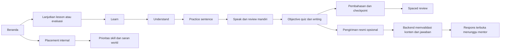

# Product requirements, information architecture, dan user flow

Status: **2.0 editorial preview**, bukan persetujuan rilis produksi.

## Sasaran

Pegawai dapat mulai belajar dalam satu klik dari dashboard. Pembelajaran mengikuti Learn → Understand → Practice → Speak → Review → Master. Materi dipelajari sebelum checkpoint lesson; placement merupakan pengecualian. Aktivitas lokal dapat digunakan tanpa akun. Identitas, kewenangan, XP dan nilai resmi berasal dari backend terautentikasi.

Keberhasilan diukur melalui bukti jawaban per skill, ulasan kesalahan, retensi, partisipasi kegiatan yang benar-benar dicatat, dan penilaian mentor. Login/XP tidak menjadi ukuran peningkatan bahasa. Tidak ada sertifikasi CEFR otomatis.

## Navigasi

| Area belajar | Fungsi |
|---|---|
| Beranda | Continue Learning, mission, review due, streak, rekomendasi, skill, upcoming session |
| Learning World | Enam world, sepuluh micro-lesson per world, checkpoint, catatan penyelesaian lokal |
| Daily Journey | Rencana 5/15/30 menit, aktivitas nyata dan progres dilanjutkan |
| Vocabulary / Grammar | Flashcard, notebook, jadwal review, 15 konsep dan drill khusus |
| Listening / Speaking | Pilihan latihan, model suara perangkat, rekam/playback, alternatif teks |
| Conversation / Tutor | 12 skenario fiktif, model respons, aturan grammar terbatas, rubrik |
| Review / Progress | Interval terjadwal, kesalahan, radar, akurasi, waktu menjawab dan riwayat |
| English Day | Kalender periode, materi/video, tugas, status published/completed |
| Achievement / Leaderboard | Badge aktivitas dan alias opt-in berdasarkan XP resmi |
| Reports / Account | Periode, sumber bukti, ekspor, privasi, migrasi progres historis |
| Mentor / Administration | Tampilan terpisah, hanya role backend dan cohort yang berwenang |

## Alur peserta

Progress lesson, daily journey, dan posisi evaluasi anonim disimpan. Respons bebas tidak dipersist ke storage setelah reload; pengguna perlu mengulang assessment terbuka sebelum pengiriman resmi. Model pertanyaan publik boleh berada di cache; identitas, token dan catatan mentor tidak masuk cache.

## Acceptance dan batas

- Semua aksi yang ditampilkan menjalankan fungsi atau menampilkan alasan akses belum tersedia. Akun produksi tidak disimulasikan saat backend kosong.
- Skor objektif minimal 80% menyelesaikan checkpoint lokal; speaking/writing tidak otomatis menjadi lulus.
- Placement singkat menggunakan minimal dua bukti pada empat skill objektif. Estimasi dibatasi A1–B1; C1/C2 memerlukan assessment lanjutan. Semua level dapat dijelajahi tanpa mengulang dasar secara paksa.
- Review mengikuti 0/1/3/7/14/30 hari; kegagalan kembali ke interval awal (10 menit). Status mastered memerlukan urutan pengulangan, bukan satu login.
- XP diberikan satu kali per pertanyaan yang dijawab benar, tanpa bonus dari pengulangan soal mudah; placement tidak memberikan XP. Nilai lokal diberi label latihan.
- Mentor hanya melihat peserta dengan cohort sama; administrator mempunyai kewenangan lintas cohort. Cohort mentor kosong berarti tidak ada kewenangan peserta.
- Backend yang belum dikonfigurasi menolak akses akun; opsi Workspace tidak diaktifkan tanpa persetujuan instansi.

## Design system

Mobile-first, layout 1 kolom di bawah 700px, grid 2–4 kolom pada desktop. Navy `#092642`, biru tombol `#215ccc`, emas CTA `#f2cc70`, permukaan terang `#ffffff`, latar `#f3f6fb`; tema gelap memakai token terpisah. Font sistem Segoe UI, line-height 1.6, radius 12–24px. Ikon/identitas existing dipertahankan.

Target interaksi sentuh 44–46px, focus-visible, skip link, label, semantic nav, reduced motion, teks alternatif, notifikasi status, skeleton dan empty/error state. Grafik menyediakan daftar/tabel nilai. Ini target desain; kepatuhan WCAG 2.2 AA menyeluruh belum disertifikasi.

Lihat [preview desktop](preview-desktop.png), [kurikulum](CURRICULUM.md), arsitektur teknis yang disampaikan privat, dan ringkasan pengujian pada README.
